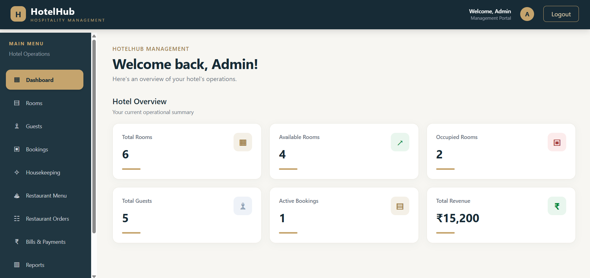
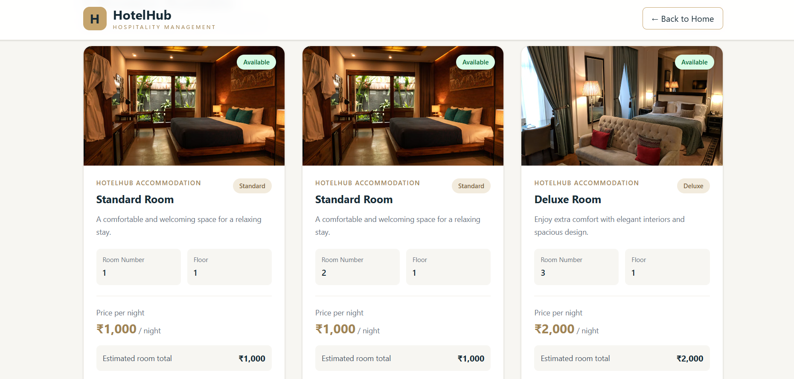
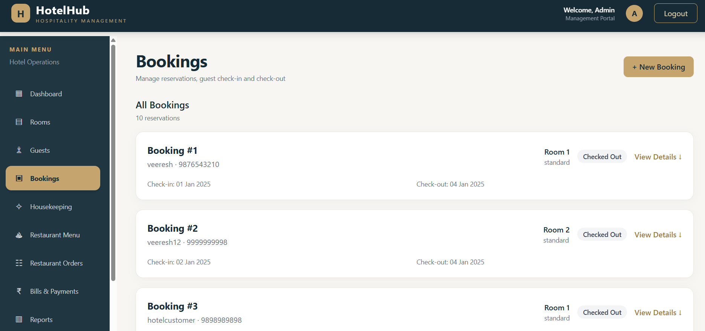
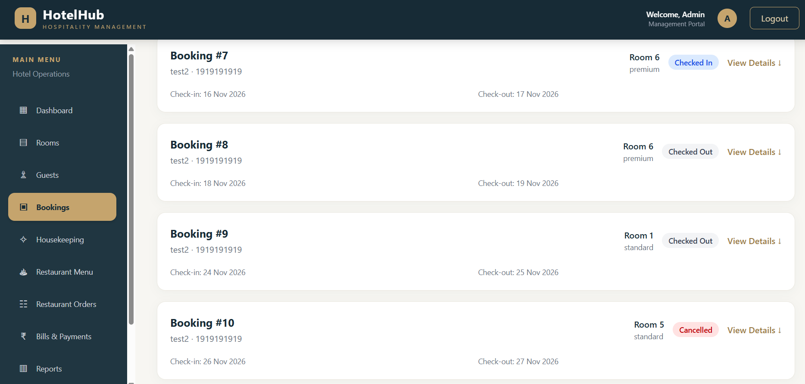
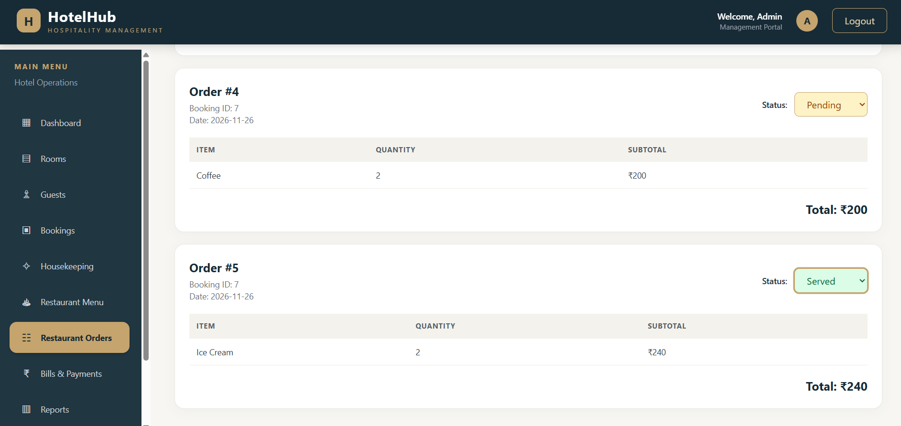
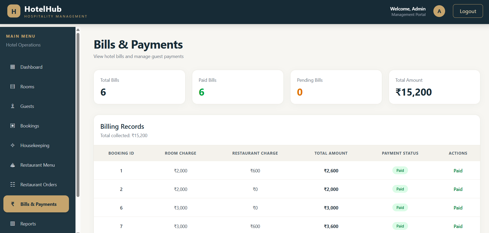
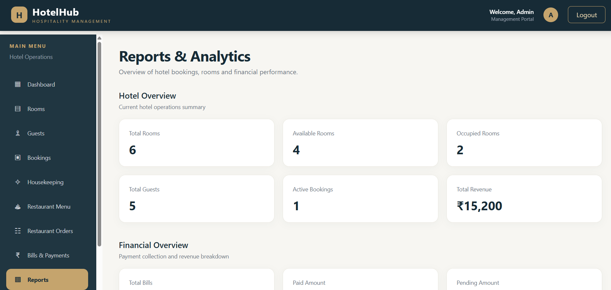

# HotelHub – Hotel & Restaurant Management System

A web-based hotel and restaurant management platform designed to simplify hotel operations, customer reservations, guest management, restaurant orders, billing, housekeeping, and reporting through a centralized system.

## Overview

**HotelHub** is a full-stack web application that provides separate Admin and Customer interfaces for managing hotel operations.

The Admin module allows hotel administrators to manage rooms, guests, reservations, restaurant operations, billing, housekeeping, and reports.

The Customer module enables users to register, log in, browse available rooms, make reservations, view booking details, and manage their bookings.

The system aims to improve operational efficiency, reduce manual work, and provide a convenient hotel management experience.

## Key Features

### Admin Module

- Secure admin authentication
- Role-based access control
- Dashboard with hotel statistics
- Room management (add, update, view, and delete)
- Guest management
- Booking and reservation management
- Check-in and check-out management
- Restaurant menu management
- Restaurant order management
- Billing and payment tracking
- Housekeeping management
- Booking, revenue, and restaurant reports

### Customer Module

- Customer registration and login
- Customer profile management
- Browse available hotel rooms
- Search room availability by dates
- Make room reservations
- View booking details
- Track reservation status
- Cancel eligible bookings

### Security Features

- Password hashing
- JWT-based authentication
- Role-based authorization
- Protected API endpoints
- Input validation using Pydantic
- Customer-specific booking access

## Technology Stack

| Layer | Technologies |
|---|---|
| Frontend | React, Vite, Tailwind CSS |
| Backend | Python, FastAPI |
| Database | SQLite |
| ORM | SQLAlchemy |
| Authentication | JWT |
| API Documentation | FastAPI Swagger UI |
| Version Control | Git, GitHub |
| Development Tools | VS Code |

## System Architecture

HotelHub follows a frontend-backend architecture.

```text
          Admin / Customer
                 |
                 v
       React Frontend (Vite)
                 |
              REST API
                 |
                 v
          FastAPI Backend
                 |
        Authentication & Logic
                 |
                 v
        SQLAlchemy ORM Layer
                 |
                 v
           SQLite Database
```

### Architecture Components

- **Frontend:** React-based interface for administrators and customers.
- **Backend:** FastAPI handles REST API requests and business logic.
- **Authentication:** JWT-based authentication and role-based access control.
- **ORM:** SQLAlchemy manages database operations.
- **Database:** SQLite stores application data, including users, rooms, guests, bookings, bills, restaurant orders, and housekeeping records.

## Project Structure

```text
hotelhub-management-system/
│
├── backend/
│   ├── app/
│   │   ├── api/
│   │   │   ├── auth.py
│   │   │   ├── bill.py
│   │   │   ├── booking.py
│   │   │   ├── customer.py
│   │   │   ├── dashboard.py
│   │   │   ├── guest.py
│   │   │   ├── housekeeping.py
│   │   │   ├── menu.py
│   │   │   ├── order_item.py
│   │   │   ├── reports.py
│   │   │   ├── restaurant_order.py
│   │   │   └── room.py
│   │   │
│   │   ├── auth/
│   │   ├── database/
│   │   ├── models/
│   │   └── schemas/
│   │
│   ├── main.py
│   └── requirements.txt
│
├── frontend/
│   ├── src/
│   │   ├── components/
│   │   ├── pages/
│   │   └── services/
│   └── package.json
│
├── .gitignore
└── README.md
```


## Application Screenshots

### Admin Dashboard


### Customer Rooms


### Booking Management


### Booking Statuses


### Restaurant Management


### Billing and Payments


### Reports and Analytics



## Installation and Setup

### Prerequisites

Make sure the following tools are installed:

- Python 3.10 or later
- Node.js and npm
- Git
- Visual Studio Code (recommended)

### 1. Clone the Repository

```bash
git clone https://github.com/Veeresh07-design/hotelhub-management-system.git

cd hotelhub-management-system
```

### 2. Backend Setup

Navigate to the backend directory:

```powershell
cd backend
```

Create a Python virtual environment:

```powershell
python -m venv venv
```

Activate the virtual environment:

```powershell
.\venv\Scripts\Activate.ps1
```

Install the required dependencies:

```powershell
pip install -r requirements.txt
```

### 3. Configure Environment Variables

Set your JWT secret key in PowerShell:

```powershell
$env:HOTELHUB_SECRET_KEY="your-secret-key"
```

For optional database and frontend configuration:

```powershell
$env:DATABASE_URL="sqlite:///hotelhub.db"
$env:FRONTEND_ORIGIN="http://localhost:5173"
```


### 4. Run the Backend

From the backend directory, start the FastAPI server:

```powershell
python -m uvicorn main:app --reload
```

Backend URL:

http://127.0.0.1:8000

API documentation:

http://127.0.0.1:8000/docs

### 5. Frontend Setup

Open another terminal and navigate to the frontend directory:

```powershell
cd frontend
```

Install frontend dependencies:

```powershell
npm install
```

Start the development server:

```powershell
npm run dev
```

Frontend URL:

http://localhost:5173

## API Documentation

HotelHub provides REST APIs through FastAPI.

The interactive Swagger documentation allows developers to explore endpoints, provide request data, authorize protected requests, and view API responses.

**Swagger UI:** http://127.0.0.1:8000/docs

Major API modules include:

| Module | Responsibility |
|---|---|
| Authentication | User login and authentication |
| Rooms | Room management and availability |
| Guests | Guest information management |
| Bookings | Reservations and booking operations |
| Customers | Customer profiles and reservations |
| Restaurant | Menu and restaurant orders |
| Billing | Bill generation and payment tracking |
| Housekeeping | Housekeeping task management |
| Reports | Booking, revenue, and restaurant reports |
| Dashboard | Hotel operational statistics |

## Future Enhancements

- Online payment gateway integration
- Email and booking notifications
- Enhanced inventory management
- Cloud deployment
- Advanced analytics and reporting
- Improved customer experience and additional features

## Author

**Veeresh S Baligar**

Computer Science and Design Engineering

GitHub: [Veeresh07-design](https://github.com/Veeresh07-design)

Project Repository: [HotelHub Management System](https://github.com/Veeresh07-design/hotelhub-management-system)

---

*HotelHub – Simplifying Hotel Operations Through Technology.*
